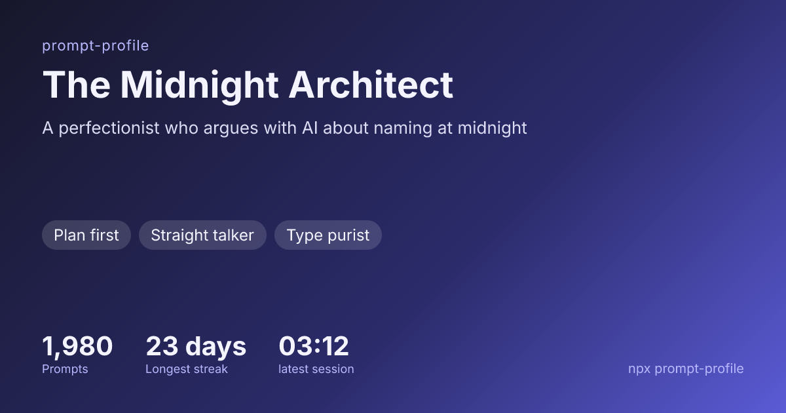
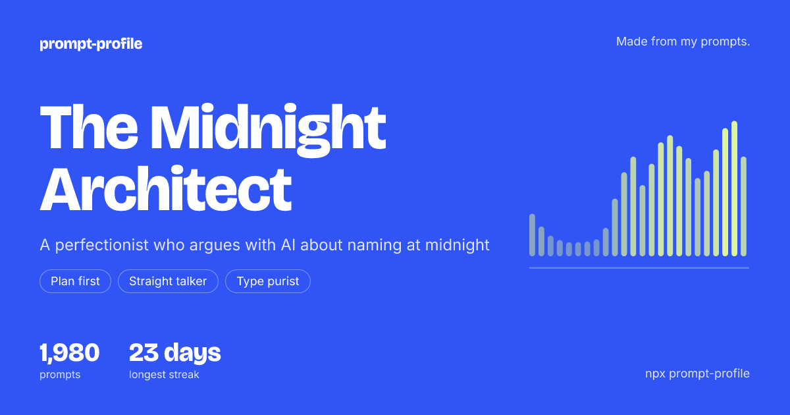
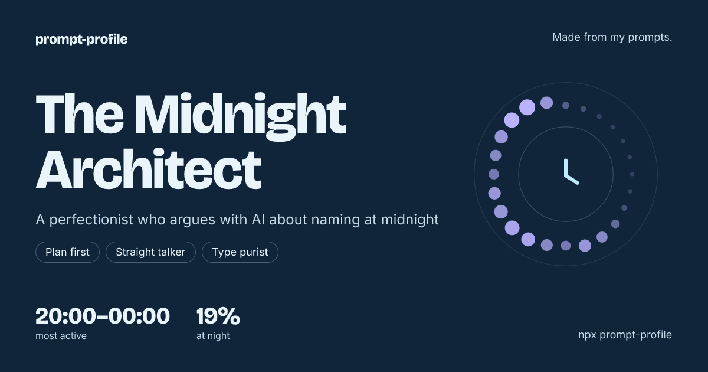
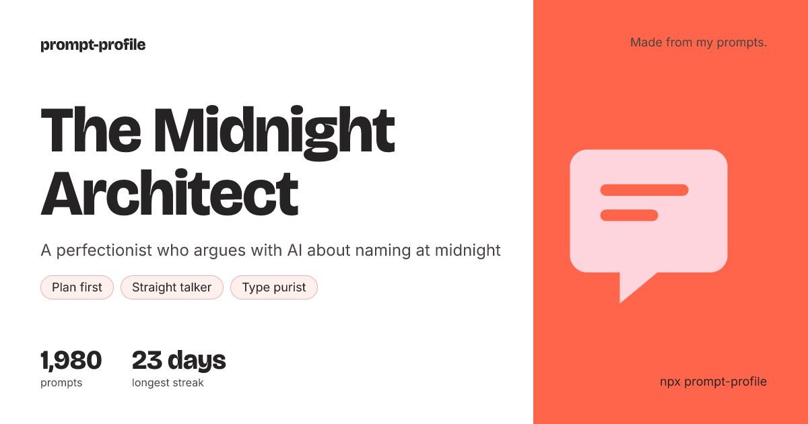

# prompt-profile

Analyze your past prompts from AI coding agents (Claude Code, Codex) locally and generate a
personal profile.



[Sample HTML report](docs/sample-report.html) · [Sample profile JSON](docs/sample-profile.json)
(all sample data is hand-written and fictional).

The same profile in the other looks (`--look signal`, `afterhours`, `studio`):

| Signal                                      | Afterhours                                          | Studio                                      |
| ------------------------------------------- | --------------------------------------------------- | ------------------------------------------- |
|  |  |  |

```bash
npx prompt-profile
# or
npm i -g prompt-profile && prompt-profile
```

Output (in `./prompt-profile-report/` by default):

- `report.html`: a single-file report that works offline — a daily calendar, prompts by hour,
  weekday and project (hover or tap any square or bar for the count and main projects), language
  and habit charts, traits, five dimensions and fun facts, with verified quotes behind collapsible
  sections, and a language switch when the report has more than one language. It shows your
  project folder names: keep it private (the card never shows them)
- `card.png`: a 1200 × 630 share card in the default language, plus `card.<lang>.png` for each
  other language (**omits evidence quotes**)
- `profile.json`: the raw profile data (re-create the report with `prompt-profile render`)

## Requirements

- Node.js ≥ 22
- [Claude Code](https://claude.com/claude-code) (`claude`) or [Codex](https://github.com/openai/codex)
  (`codex`) installed and logged in
- **No API key needed**: the analysis runs your own logged-in `claude -p` or `codex exec` in the
  background and **uses your subscription quota**. The base call estimate is shown
  before confirmation. Intermediate merges and up to two retries per call can add calls;
  use `--max-calls` to set a hard limit on CLI invocations, including retries.

## Usage

```bash
prompt-profile                 # analyse the last 6 months and write the report
prompt-profile --since 3m      # 1m / 3m / 6m / 1y / all (also <n>d, <n>w)
prompt-profile --engine codex  # which CLI analyses your prompts (default: auto, Claude Code first)
prompt-profile --model <name>  # model passed to claude / codex
prompt-profile --out <dir>     # output folder
prompt-profile --max-calls 40  # cap CLI invocations, including merges and retries
prompt-profile --full          # no sampling, analyse everything (slower, uses more quota)
prompt-profile --no-cache      # do not read the analysis cache
prompt-profile --yes           # skip the confirmation (required in non-interactive sessions)
prompt-profile --dry-run       # write what would be sent to the LLM into --out, call nothing
prompt-profile --verbose       # full errors and LLM call timings
prompt-profile --lang zh-TW,en # report languages, the first is the default (en, zh-TW)
prompt-profile --look signal   # classic (default) / signal / afterhours / studio
prompt-profile --card-hide stats,graphic  # leave traits / stats / graphic out of card.png

prompt-profile stats                  # statistics only, no LLM (free and fast)
prompt-profile render profile.json    # re-create the report from an existing profile.json
prompt-profile cache clear            # delete the analysis cache

prompt-profile render profile.json --look studio --card-hide stats
                                      # a new look, written to variants/studio-no-stats/
```

Looks and `--card-hide` only change how the report and card are drawn: no new analysis and no
LLM calls, and the original report is kept. `--card-hide` changes the share card only; the
private report and `profile.json` still contain everything, including quotes. The card never
contains quotes or project names in any look.

Exit codes: `0` success · `1` error · `2` usage / needs `--yes` · `3` no data · `4` no usable LLM
CLI · `5` rate limited · `130` interrupted (a re-run resumes from the cache).

## Privacy

**Files read** (read-only):

| Source      | Paths (override with an environment variable)                                   |
| ----------- | ------------------------------------------------------------------------------- |
| Claude Code | `~/.claude/projects/*/*.jsonl`, `~/.claude/history.jsonl` (`CLAUDE_CONFIG_DIR`) |
| Codex       | `~/.codex/sessions/**/rollout-*.jsonl`, `~/.codex/history.jsonl` (`CODEX_HOME`) |

**Prompt selection and preprocessing**: adapters select user prompts, excluding recognized system
messages, tool output and sub-agent conversations, then:

- pasted code / logs are collapsed into `[pasted code: N lines]`
- API keys, tokens, passwords, private keys, connection strings, emails, phone numbers, national
  IDs, credit card numbers, internal URLs, UUIDs / hashes, home-folder paths and usernames that
  match the supported rules are redacted **before** anything is sent (and before long
  prompts are shortened); this is best-effort, not a guarantee that every secret is found
- projects are reduced to their folder name, never the full path
- `prompt-profile --dry-run` previews selected map chunks; generated observations, statistics
  used by the final step, system instructions and retry messages are not a complete network dump

Selected, cleaned and redacted prompt text is sent **off your machine** through your logged-in
CLI to its model service, along with project basenames. Intermediate observations, supporting
quotes and usage statistics are sent during merge/final analysis. Text that does not match a
redaction rule can remain unchanged, including names and confidential prose.

Reports, `profile.json`, dry-run exports and analysis caches are written locally and are not
uploaded by prompt-profile. They can contain personal information. Created folders use `0700`
and files use `0600`; existing folder permissions are not changed. `cache clear` removes analysis
entries only, and reports deletion errors rather than claiming success. Delete reports and dry-run
exports separately when no longer needed.

Claude runs with safe mode, tools disabled, strict MCP configuration and disabled hooks. Codex
runs with `--ignore-user-config`, disabled hooks/notifications, a read-only sandbox and an ephemeral
session. Codex still uses your existing login, but user-configured providers and model defaults
are ignored; specify the model with `--model`. Both use fresh temporary working folders.
Administrator policy, environment settings and CLI/provider diagnostics can still apply. These
controls are tested on specific versions, and do not promise zero CLI/provider logs or traffic.
See [runner notes](src/llm/NOTES.md) and the [security policy](SECURITY.md).

prompt-profile has no telemetry. The report makes no network requests and its fonts ship with
the package. The one exception is the Chinese share card: on first use it downloads Noto Sans TC
(about 11 MB, from a pinned GitHub commit), checks its SHA-256 and caches it; no prompt data is
sent. The borrowed CLI manages its own network requests and provider data retention.

Languages: without `--lang`, a Chinese system locale gives a Traditional Chinese report with an
English switch (`zh-TW,en`); any other locale gives English. The profile is written in English
and then translated, one extra CLI call per extra language; quotes stay as you wrote them.

## FAQ

**How much quota does it use?** By default at most 30 chunks (about 40,000 characters each) are
analysed, plus intermediate merges for large histories and one final call. Each call may retry
twice. The displayed count is a base estimate, not an upper bound; `--max-calls` limits total CLI
invocations rather than tokens, provider requests or money.
Chunks analysed before are read from the cache on the next run.

**Can I use an API key?** Not at the moment: by design it only borrows your logged-in CLI.

**Is the report accurate?** Every trait and dimension cites quotes from your prompts, and the
program checks that each quote really exists in them. Invalid and duplicate quotes are removed;
multiple excerpts of one prompt do not count as independent support, and high-confidence traits
require support from multiple sessions. Quote matching does not prove the interpretation is correct.
Dimensions without verified quotes are marked as insufficiently supported.

**Why are some prompts not counted?** Short acknowledgements ("ok", "continue"), resent duplicates,
notifications sent by the tools themselves, long templates repeated across sessions, and slash
commands of sessions that contain nothing else (scripts and tools) are excluded. Each run shows
how many were excluded.

**My prompts are not in English.** That is fine: prompts in any language are analysed (Chinese
gets extra handling for acknowledgements and corrections). The report is written in English;
quotes stay in their original language.

prompt-profile is not affiliated with or endorsed by Anthropic or OpenAI.

## Development

See [CONTRIBUTING.md](CONTRIBUTING.md), [AGENTS.md](AGENTS.md) and [plans/](plans/README.md).
CI covers Linux (Node.js 22/24) and macOS (Node.js 24); Windows is unverified.
CLI behavior was checked with Claude Code 2.1.309 and codex-cli 0.164.0; upgrade the CLI if an
isolation flag is not recognized. `pnpm test:package` checks the installed npm tarball, including
bundled prompts, fonts, WASM rendering and file permissions.

## License

MIT
